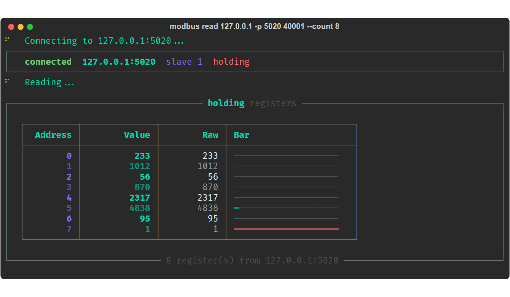
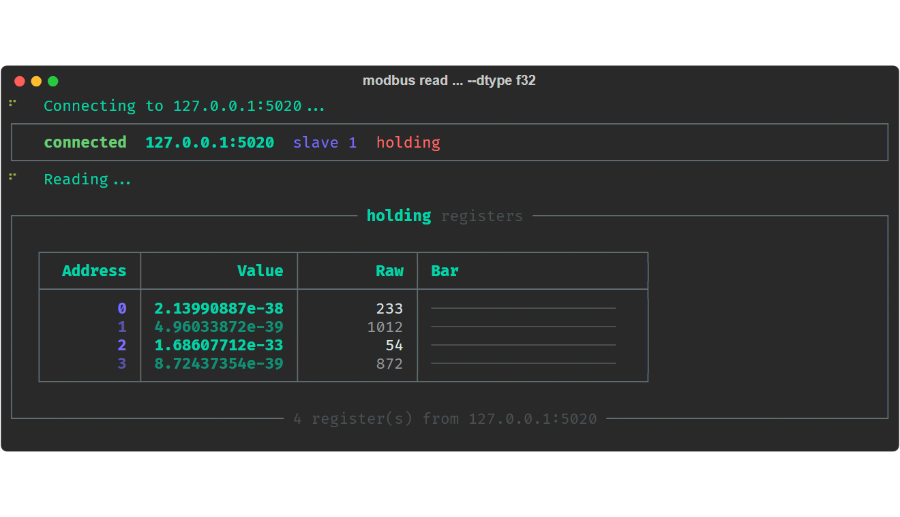
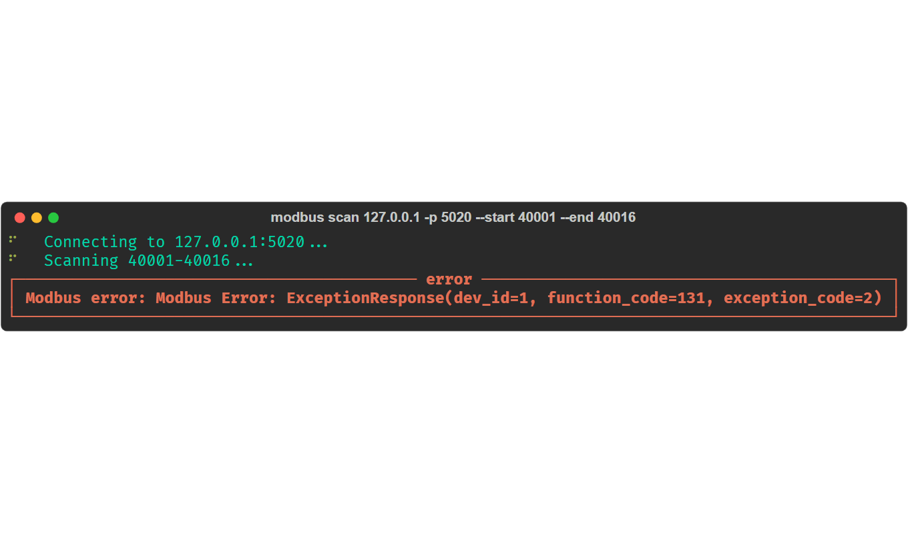
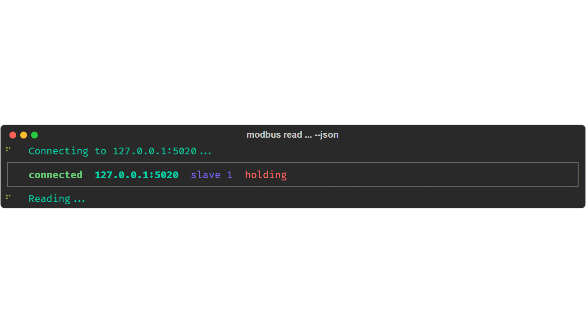

# modbus
**Command-line Modbus client for PLCs, VFDs, energy meters, and RTUs, with rich terminal output**

[](LICENSE)


## Table of Contents

- [Overview](#overview)
- [Key Features](#key-features)
- [Requirements](#requirements)
- [Installation](#installation)
- [Usage](#usage)
- [Screenshots](#screenshots)
- [Scripting and JSON](#scripting-and-json)
- [Related Links](#related-links)
- [License](#license)

## Overview

modbus reads and writes registers, coils, and discrete inputs over TCP, UDP,
RTU, ASCII, or TLS. It speaks standard Modbus address notation (`40001` for
holding registers, `30001` for input, and so on), converts raw registers into
engineering datatypes (`f32`, `i32`, `str`, ...), and renders results as rich
tables with value bars. An embedded simulator lets you try every command
without any hardware.

## Key Features

- Five transports: TCP, UDP, RTU, ASCII (serial), and TLS with client certificates
- Nine commands: `read`, `write`, `fill`, `save`, `restore`, `scan`, `watch`, `simulate`, `tui`
- Datatype conversion (`u16`..`f64`, `str`) with byte/word order and `--scale` for engineering units
- Watch mode with change detection, plus an interactive REPL with named connections
- Embedded test server with drifting sensor values (temperature, pressure, flow, RPM, ...)
- Machine-readable `--json` output; diagnostics go to stderr so stdout stays clean

## Requirements

- Python 3.10+
- [pymodbus](https://pymodbus.readthedocs.io/) 3.5+ and [rich](https://rich.readthedocs.io/) 13+ (installed automatically)
- [textual](https://textual.textualize.io/) only for the full-screen TUI extra

## Installation

```bash
pip install git+https://github.com/DarkSoulEngineer/modbus.git
```

Or from a checkout:

```bash
git clone https://github.com/DarkSoulEngineer/modbus.git
cd modbus
pip install -e .          # add '.[tui]' for the TUI extra
```

## Usage

Start the embedded simulator in one terminal (no hardware needed):

```bash
modbus simulate --port 5020
```

Then, in a second terminal:

```bash
# Read 8 holding registers starting at 40001
modbus read 127.0.0.1 -p 5020 40001 --count 8

# Read 4 float32 values
modbus read 127.0.0.1 -p 5020 40001 --count 4 --dtype f32

# Write two registers (FC16)
modbus write 127.0.0.1 -p 5020 40101 123 456

# Sweep a range for non-zero registers
modbus scan 127.0.0.1 -p 5020 --start 40001 --end 40099

# Poll with change detection (Ctrl+C to quit)
modbus watch 127.0.0.1 -p 5020 40001 --count 6 --interval 1

# Interactive shell with multiple named connections
modbus tui
```

Against real devices, drop `-p 5020` (port 502 is the default) or use a serial
transport:

```bash
modbus read COM3 --transport rtu --baudrate 19200 40001 --count 10
modbus read 10.0.0.5 --transport tls --port 802 --cert client.pem --key client.key
```

Address notation auto-detects the register type: `40001-49999` holding,
`30001-39999` input, `10001-19999` discrete, `1-9999` coil; raw 0-based offsets
also work. Protocol limits (FC3/FC4 125 registers, FC16 123, ...) are checked
before any request is sent. Exit codes are deterministic (0 success, 2 usage,
3 connection, 4 Modbus exception, 5 timeout) for unattended scripts.

## Screenshots

Reading holding registers from the embedded simulator:



Float32 decoding and range scanning:





## Scripting and JSON

`--json` prints one structured object per command (or per poll, for `watch`)
on stdout; banners and diagnostics stay on stderr:



```bash
modbus --no-banner read 127.0.0.1 -p 5020 40001 --count 6 --json | jq '.values[].value'
```

See [CONTRIBUTING.md](CONTRIBUTING.md) for development setup and
[CHANGELOG.md](CHANGELOG.md) for release history.

## Related Links

- **[pymodbus](https://pymodbus.readthedocs.io/)**: the Modbus protocol stack used under the hood.
- **[Modbus Application Protocol V1.1b3](https://www.modbus.org/docs/Modbus_Application_Protocol_V1_1b3.pdf)**: function codes and limits.
- **[rich](https://rich.readthedocs.io/)**: terminal tables, panels, and bars.

## License

MIT. See [LICENSE](LICENSE).

> [LinkedIn](https://www.linkedin.com/in/milchis-catalin-marian-824b61335/) &nbsp;&middot;&nbsp;
> GitHub [@DarkSoulEngineer](https://github.com/DarkSoulEngineer)